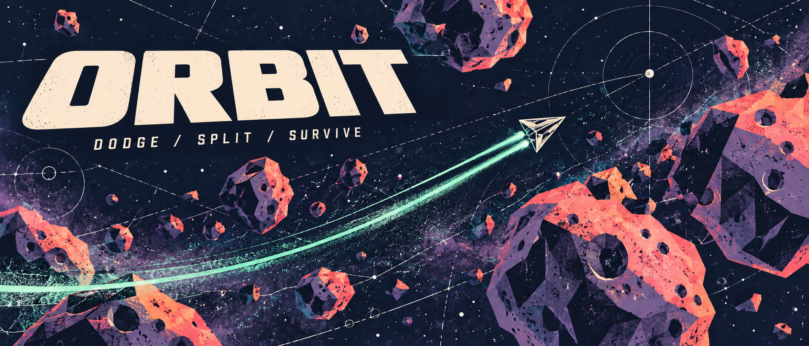
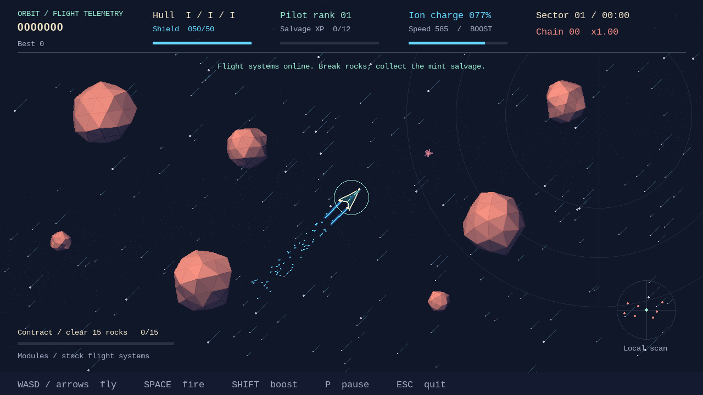

# Orbit — Asteroids Game

**A keyboard-controlled arcade game built with Python and Pygame.**

Pilot an upgradeable starfighter through rotating, shaded asteroids. Fly with momentum, boost through a layered starfield, and leave twin cyan engine trails. Collect salvage to choose new modules, recharge shields between impacts, and chain kills for bonus points. The game uses a 1280 × 720 Pygame window capped at 60 frames per second.

[Launch the game](#-quick-start)

##  Features

- Rotating 3D rock meshes, lit coral faces, violet shadows, and impact particles.
- Flight-reactive star parallax, boost streaks, and twin cyan exhaust trails.
- Inertial flight, rechargeable boost energy, shields, and three hull lives.
- Salvage XP, pilot ranks, and six module types with keyboard upgrade choices.
- Kill-chain multipliers, escalating contracts, telemetry, and a local radar.
- Pause, restart, persistent best score, and reduced-motion mode.

##  Installation

Requires a **Linux or macOS graphical desktop**, Bash, and `curl` or `wget`.
The first launch needs internet access. Python and uv do not need to be installed
in advance: the launcher downloads uv into the ignored `.tools/` directory when
needed, then uv prepares Python 3.13 and the locked Pygame dependency in `.venv/`.
An existing uv installation is reused. No sudo or shell-profile changes are needed.

```bash
git clone https://github.com/yaqyn/orbit-asteroids-game.git
cd orbit-asteroids-game
```

##  Quick start

```bash
./launch
```

Wait for first-run setup to finish, then press **Enter** on the Orbit title screen.
Subsequent launches reuse the environment. Press **F11** for fullscreen and
**Escape** to quit.

| Key | Action |
| --- | --- |
| **W / S** or **Up / Down** | Thrust forward / backward |
| **A / D** or **Left / Right** | Rotate left / right |
| **Space** | Shoot |
| **Shift** + thrust | Boost using ion charge |
| **1 / 2 / 3** | Install a module on the rank-up screen |
| **Enter** | Start, resume, or play again |
| **P** | Pause / resume |
| **F11** | Toggle fullscreen |
| **M** | Toggle reduced motion |
| **R** | Restart while paused or after game over |
| **Escape** or close window | Exit |



<sub>Deterministic scene rendered from the project’s sprite classes; a visual preview rather than a recorded gameplay session.</sub>

##  Usage and options

The launcher installs the locked environment automatically and works
from another directory when invoked by absolute path. `uv run main.py` remains
available if uv is on your PATH. The window is resizable; fullscreen uses the native desktop resolution. A
1280 × 720 game canvas scales to fit while preserving its aspect ratio, with black
bars where needed. F11 switches modes without resetting the run.

The ship wraps around screen edges; shots expire after 1.6 seconds,
and off-screen rocks are removed. Small rocks score 100 points, medium rocks 50,
and large rocks 20. Shields absorb 25 points per impact; an unshielded hit removes one
life. Shields recharge at 5 points per second after six seconds without impact.
Respawns stop the ship and grant two seconds of protection. Losing desktop focus pauses the run.

Collect mint salvage diamonds before they expire after 14 seconds. The tractor
pulls nearby salvage toward the ship. Each rank offers up to three modules while
combat is frozen: reduce cannon delay, improve thrust, expand shields, extend the
tractor range, unlock triple shots, or restore hull and shields. Press the number
shown to install a module. **Modules and ranks last for the current run.**

Every five kills in a chain adds 0.25 to the score multiplier, up to ×2; three
seconds without a kill or taking damage clears the chain. Contracts reward
500 score and 8 XP at increasing kill targets. Boost drains ion charge; release
Shift after exhaustion to rearm it. Charge regenerates when not boosting.

```bash
./launch --fullscreen
./launch --reduced-motion
```

Reduced motion disables particles, star parallax/twinkle/streaks, and asteroid
rotation; a steady ring still shows protection. The best score is saved on game over or exit under
`$XDG_STATE_HOME/asteroids/best.json` (default `~/.local/state/asteroids/best.json`).
The legacy save location is retained so existing scores survive the Orbit rename.
Use `--score-file PATH` for a portable or isolated best-score file.
Press **B** on the title or game-over screen to clear the saved best score.
Score saves use unique temporary files and atomic replacement; a failed replacement preserves the previous score and cleans up its temporary file. If saving fails, the best remains in memory and the menu shows a message.
The game has no audio and does not require external media downloads.

##  Architecture

Each frame processes input, updates sprites, resolves collisions, and draws the resulting state.


Sprite groups coordinate updates and drawing. Circle-based collision checks connect shots, asteroids, and the player; asteroid spawning and splitting live in dedicated classes.

| Source | Responsibility |
| --- | --- |
| `main.py` | Event loop and launch options |
| `display.py` | Native fullscreen, resizing, canvas scaling, and presentation |
| `game.py` | State transitions, shields, contracts, ranks, scoring, and persistence |
| `progression.py` | Salvage attraction and upgrade definitions |
| `ui.py` | Shared HUD, menus, starfield, and reduced-motion presentation |
| `player.py` · `shot.py` | Ship controls and projectiles |
| `asteroid.py` · `asteroidfield.py` | Rocks, splitting, and spawning |
| `circleshape.py` | Shared circular shape and collision logic |
| `constants.py` | Dimensions, movement, and firing settings |

##  Verification

```bash
uv run python -m unittest -v
SDL_VIDEODRIVER=dummy ./launch --start --seed 7 --frames 120 --no-save
```

Tests cover scoring, splitting, shields, boost/drag, salvage, rank-up freezing,
module installation/caps, contracts, particle limits, reduced-motion spawn parity,
pause/restart, cleanup, score-save recovery, and rendering every screen. GitHub Actions
runs the tests and a deterministic headless launch. Optional `--screenshot PATH`
saves the final frame; `--no-save` keeps verification runs from writing scores.
For a reproducible CPU renderer stress test (80 rocks, 240 frames, no combat,
frame limiter, or display presentation):

```bash
uv run benchmark.py --headless
```

The report includes average and 95th-percentile render times in milliseconds.
Results depend on the machine; they measure rendering rather than end-to-end FPS.
Asteroid rasters are cached between small rotation changes, small rocks use fewer
facets, and text/overlay caches avoid repeated allocations.

[Design context](DESIGN.md) documents the shared presentation and controls.

##  Learning context

The course foundation covers object-oriented design, vector movement, sprite
groups, and collision detection. Extensions add 3D mesh projection and lighting,
render caching, fullscreen presentation, inertial flight, run-local progression,
and resilient score persistence.

---

Built by **[Abdulrahman M. Yaqyn](https://yaqyn.github.io/folio-static-site/)**.

> **Learning Journey Project · Boot.dev**
> Developed through the Boot.dev curriculum and extended through independent work.
